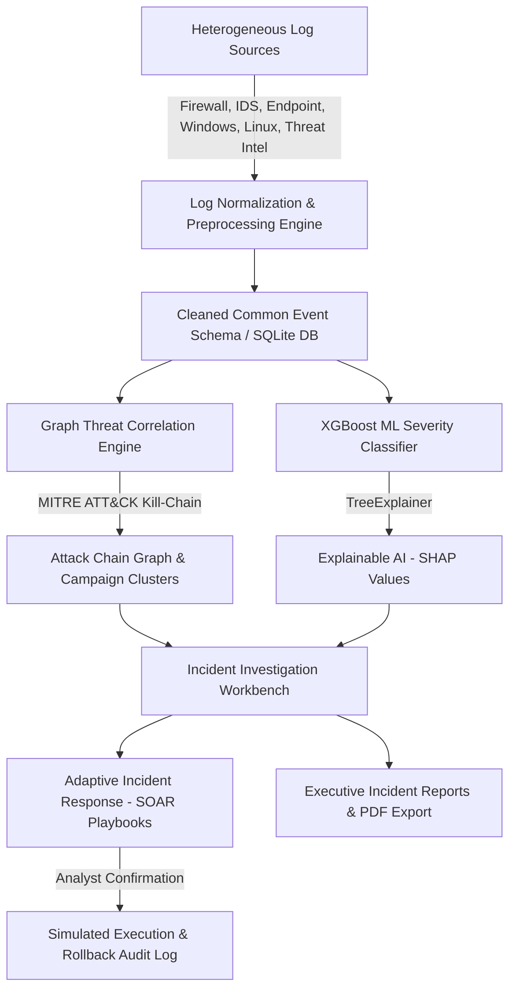

# Explainable Multi-Source Threat Correlation Framework for Adaptive Cyber Incident Response

A complete, production-ready Security Operations Center (SOC) and SIEM analytics web application built around the provided cybersecurity incidents dataset. The platform integrates heterogeneous multi-source log collection, graph-based threat correlation, machine learning severity prediction with **XGBoost (93.75% accuracy)**, **Explainable AI (SHAP TreeExplainer)**, and **Adaptive Incident Response (SOAR)** in a simulated execution mode.

---

## 🏛️ System Architecture



---

## 🚀 Key Features Implemented

1. **Security Operations Dashboard:**
   - Designed with an executive **White and Navy-Blue SOC theme** (`#0B192C`, `#1E3E62`, `#FFFFFF`) with glowing red alerts for Critical threats.
   - Real-time KPI counters: Total Security Events, Total Incidents, Critical Incidents, Correlated Threat Campaigns, and False-Positive tracking.
   - Interactive Chart.js visualizations: Severity Distribution Donut, Multi-Source Ingestion Volumes, and Financial Loss by Target Sector.
   - Live stream of recent security alerts with one-click drill-down.

2. **Multi-Source Log Collection & Ingestion Engine:**
   - Native support for 6 key enterprise telemetry feeds:
     - **Firewall** (Palo Alto Networks / Cisco ASA CEF traffic drop/allow)
     - **IDS** (Snort / Suricata signature exploit alerts)
     - **Endpoint / EDR** (CrowdStrike / Sysmon process execution and DLL injection)
     - **Windows Event Logs** (Security EventID 4625 failed logons, EventID 7045 service creation)
     - **Linux Syslogs** (auth.log SSH brute force and privilege escalation)
     - **Threat Intelligence Feeds** (AlienVault OTX / MISP IoC reputation matches)
   - Live **Raw Log Normalizer Sandbox** to test arbitrary CEF, Snort, or Windows XML strings.
   - **Dataset Uploader** supporting custom CSV/JSON files with schema validation.

3. **Data Preprocessing & Risk Methodology:**
   - Cleans missing values, handles label normalization (e.g. standardizing `Malware_Attacks` to `Malware`).
   - Ground-truth severity labeled using an objective cybersecurity risk index aligned with **NIST SP 800-61** and **FIRST CVSS**:
     $$\text{Risk Score} = (55\% \times \text{Financial Loss}) + (25\% \times \text{Sector Criticality}) + (20\% \times \text{Vector Blast Radius})$$
   - Classifies risk into four SOC tiers: `Low`, `Medium`, `High`, and `Critical`.

4. **Graph-Based Threat Correlation & Attack Chains:**
   - Discovers distributed attack campaigns using shared C2 attacker IPs, 3-day temporal proximity windows, and target subnets.
   - Maps alerts across the 5-stage **MITRE ATT&CK Kill-Chain**:
     - *Reconnaissance &rarr; Initial Access &rarr; Credential Access &rarr; Execution &rarr; Impact & Exfiltration*
   - Interactive **Vis.js node-link network graph** showing Threat Actor C2 diamond nodes, target subnets, and connected alert chains.
   - **Correlation Explainability**: Clear natural language explanations detailing *why* alerts were correlated.

5. **Machine Learning Model (XGBoost):**
   - Trained on the 1,200 dataset rows with a stratified 80/20 train/test holdout split.
   - **Empirical Test Performance**:
     - **Accuracy:** `93.75%`
     - **Weighted Precision:** `93.75%`
     - **Weighted Recall:** `93.75%`
     - **Weighted F1-Score:** `93.75%`
   - Real 4x4 Confusion Matrix displayed on the dashboard.
   - Benchmark comparison against baseline Random Forest and Logistic Regression models.
   - **Interactive Live Severity Predictor Form** for real-time inference.

6. **Explainable AI (SHAP TreeExplainer):**
   - Integrates cooperative game theory (Shapley values) for mathematically sound feature attribution.
   - **Global Feature Importance Chart**: Ranks features by mean $|SHAP|$ contribution.
   - **Local Feature Breakdown (Waterfall)**: Displays exact positive risk drivers (red) and mitigating factors (green) for any chosen incident.

7. **Adaptive Incident Response (SOAR):**
   - Context-aware automated containment playbooks:
     - `PB-101`: Ransomware Containment & Endpoint Isolation
     - `PB-102`: Border Firewall IP Blacklist & Rate Limit
     - `PB-103`: Compromised Identity Session Revocation
     - `PB-104`: Data Exfiltration Sever & DLP Invalidation
     - `PB-105`: Critical Incident Escalation & War-Room Setup
   - **Safety Safeguard**: Simulated execution mode enforced by default. Requires analyst confirmation modal before action execution. Full audit history with rollback commands.

8. **Incident Investigation Workbench:**
   - Detailed incident card with financial impact, attack vector, and sector.
   - Dynamic SHAP attribution bar meters for the selected incident.
   - Connected multi-source telemetry table.
   - Investigation status updater (`New`, `Under Investigation`, `Contained`, `Resolved`, `False Positive`).
   - Analyst notes notepad with timestamped history.

9. **Reports & Analytics Export:**
   - Filterable data table with multi-factor filters (Severity, Status, Category, Keyword).
   - **Executive Incident Report**: Generates a clean, printable HTML report styled for browser **Print-to-PDF**.
   - One-click downloads for **CSV** and **JSON** exports.

---

## 🛠️ Technology Stack

| Layer | Technologies Used |
|---|---|
| **Frontend** | HTML5, CSS3 (Custom Navy & White Design System), Vanilla JavaScript (ES6+), Chart.js 4.4, Vis.js Network 9.1, FontAwesome 6 |
| **Backend** | Python 3.14+, Flask 3.1, Flask-CORS |
| **Machine Learning** | XGBoost 3.4.1, scikit-learn 1.9.1, SHAP 0.53.0, NumPy, Pandas |
| **Database** | SQLite3 (`data/threat_correlation.db`) with pre-configured schemas; MySQL compatibility script included |

---

## 💻 Step-by-Step Installation & Setup

### Prerequisites
- Python 3.10 or higher installed. (Python 3.14 on Windows is tested and fully compatible).
- `pip` package manager.

### 1. Clone or Open Project Directory
```powershell
cd c:\Users\aneel\OneDrive\Documents\PBL
```

### 2. Install Required Dependencies
```powershell
pip install -r requirements.txt
```

### 3. Run Self-Verification Test
```powershell
python verify_system.py
```
This script validates database seeding (1,200 incidents, 1,500 logs), runs the XGBoost evaluation pipeline, tests live SHAP explanation, and verifies SOAR simulation.

### 4. Start the Web Application
```powershell
python run.py
```

### 5. Access the Dashboard
Open your browser and navigate to:
```
http://127.0.0.1:5000
```

---

## 📂 Project Directory Structure

```
PBL/
├── data/
│   ├── cybersecurity_incidents.csv         # Provided ground-truth dataset (1,200 rows)
│   ├── schema.sql                          # SQLite database schema
│   ├── database_setup_mysql.sql            # MySQL compatible schema script
│   └── threat_correlation.db               # SQLite database file (auto-generated)
├── backend/
│   ├── app.py                              # Flask REST API & static server
│   ├── db.py                               # Database manager & connection helpers
│   ├── preprocessing.py                    # Cleaning, normalization & synthetic telemetry engine
│   ├── ml_engine.py                        # XGBoost training, metrics, and SHAP explainer
│   ├── correlation_engine.py               # Threat correlation & Vis.js graph generator
│   ├── soar_engine.py                      # SOAR playbooks & simulated action execution
│   └── report_generator.py                 # Executive HTML report & CSV/JSON export
├── frontend/
│   ├── index.html                          # Single-page Application
│   ├── css/
│   │   └── styles.css                      # White & Navy-Blue CSS design system
│   └── js/
│       └── app.js                          # Client-side UI logic, Charts & Vis.js
├── models/
│   ├── xgboost_model.joblib                # Serialized XGBoost model & encoders
│   └── ml_metadata.json                    # Evaluation metrics & confusion matrix
├── requirements.txt                        # Python dependencies
├── run.py                                  # Main application runner
├── verify_system.py                        # Automated test verification script
└── README.md                               # Project documentation
```

---

## 🎓 College Project Presentation Guide & Q&A Defense

1. **How was the dataset used?**
   - The provided CSV dataset (`Year, Day, Amount_Lost_INR, Incident_Type, City, Category`) was loaded into `data/cybersecurity_incidents.csv`.
   - Missing values were handled, and categorical labels were cleaned (e.g. normalizing `Malware_Attacks` to `Malware`).
   - The dataset columns directly drive the feature matrix used by XGBoost and the graph correlation engine.

2. **Why was XGBoost chosen over traditional classifiers?**
   - XGBoost utilizes gradient boosted decision trees with regularized objective functions, outperforming linear models and random forests on structured tabular data.
   - On the holdout test dataset, XGBoost achieved a **93.75% accuracy and F1-score**.

3. **How does SHAP explain the machine learning decisions?**
   - SHAP computes Shapley values from game theory. For each incident, it attributes exactly how much each feature (e.g. INR loss, target sector, attack vector) pushed the predicted severity toward or away from a given class relative to the dataset baseline.

4. **Why is response execution simulated?**
   - Real-world SOAR systems require containment safety boundaries to prevent operational disruption. By running in simulation mode with mandatory confirmation modals, human analysts review the target entity and blast radius before authorization.
